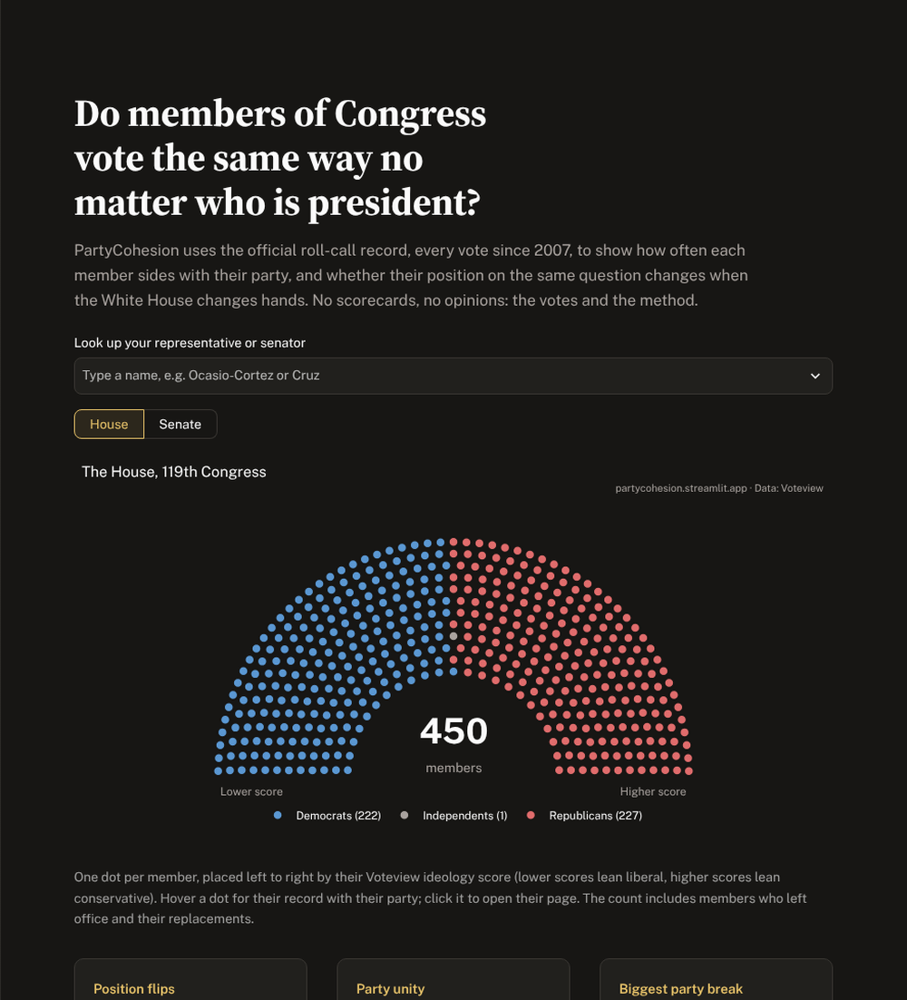
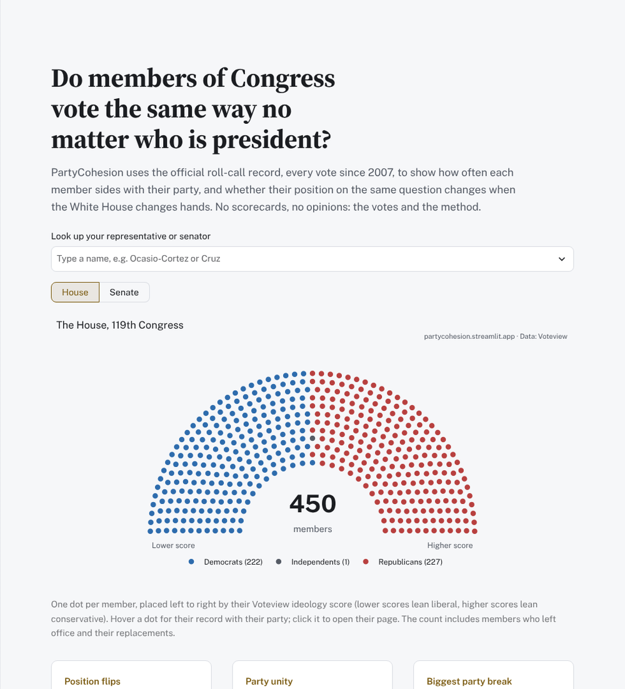
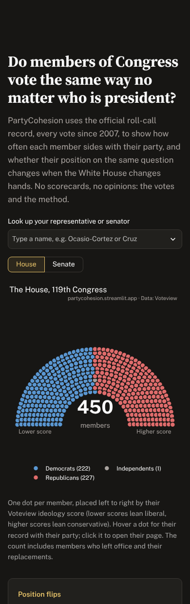
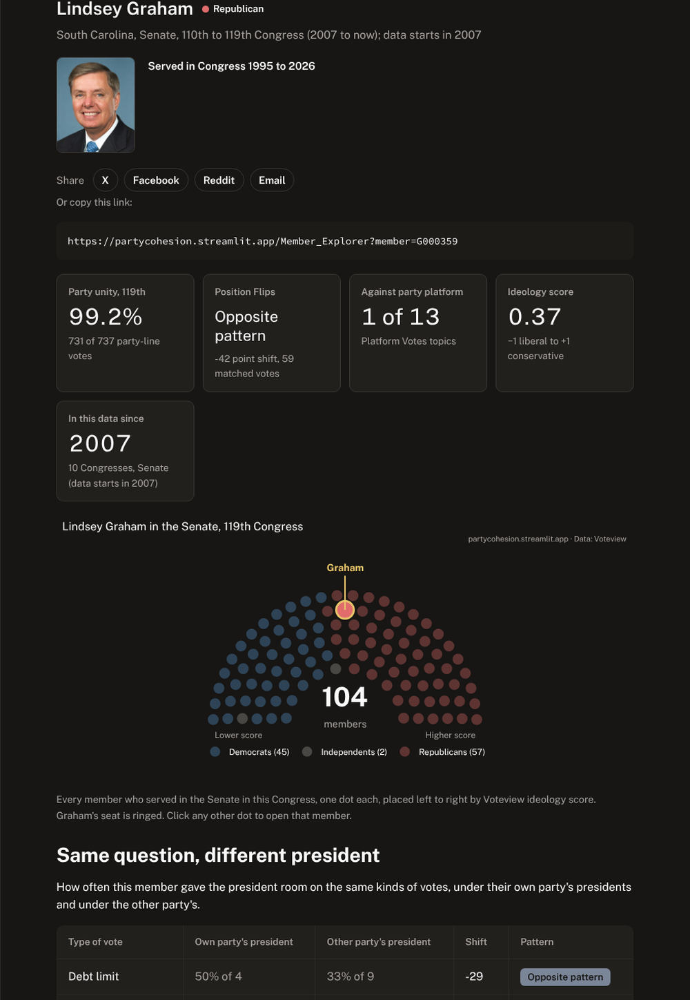
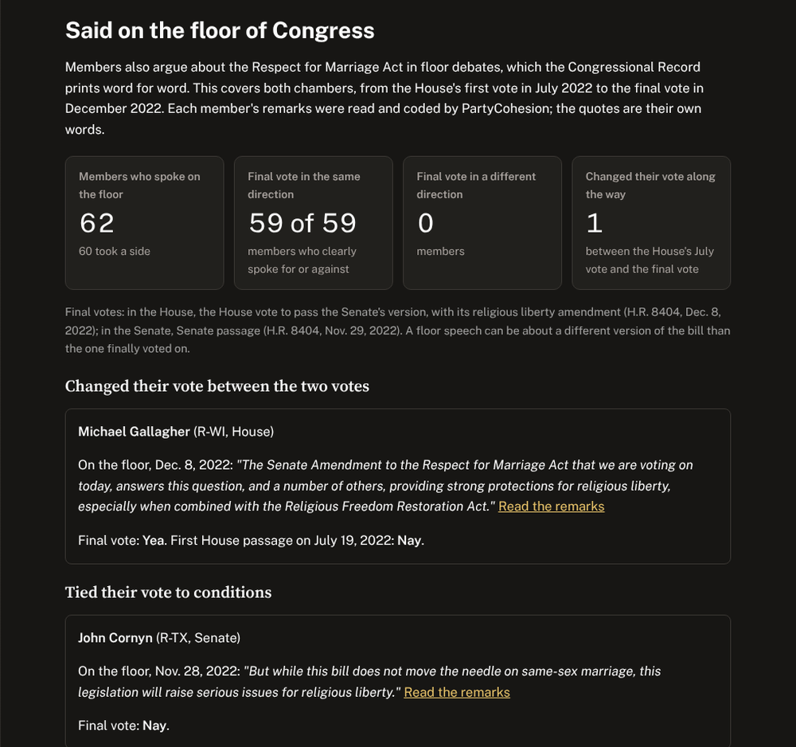

# PartyCohesion

**Do members of Congress vote the same way no matter who is president?**

PartyCohesion is a free, neutral site built on the official roll-call record. It covers every House and Senate vote since 2007: 19,574 roll calls and 1,344 members. It shows how often each member sides with their party, whether their vote on the same question changes when the White House changes hands, and how their votes line up with what they said on the campaign trail and on the floor of Congress. It has no scorecards and no opinions, just the votes and the method.

**Live site:** https://partycohesion.streamlit.app



<p>


</p>

## What you can find

| Page | What it answers |
|---|---|
| **Members** | One member's full record: party unity, whether their votes shift with the president, their seat in the chamber, and every roll call they cast |
| **Position Flips** | Did a member cast the same vote on debt limits, stopgap funding and war powers under presidents of both parties? |
| **Platform Votes** | Votes where the two party platforms took opposite positions, and who voted against their own party's platform |
| **Cosponsored, Then Voted No** | Members who signed on to a bill and then voted against it, and whether its text had changed first |
| **Campaign Statements and Votes** | What House candidates wrote on their campaign websites, and what members of both chambers said in floor debates, next to how they voted |
| **Key Votes** | The highest-profile votes in each Congress and exactly who crossed party lines |
| **All Votes** | Search every roll call by bill number or title |
| **Compare Members** | Two members side by side: agreement while serving together and where they split |
| **Overview, Ideology Drift** | Party unity and ideology trends, Congress by Congress |
| **How We Measure Consistency, Methodology** | Every definition, cutoff and data source |




## How it's built

**Data, all public and free.** No paid APIs.

| Source | Used for |
|---|---|
| [Voteview](https://voteview.com/) (UCLA) | Every roll call, every member's vote, DW-NOMINATE ideology scores |
| [GovInfo](https://www.govinfo.gov/) bill status files | Sponsors, cosponsors and amendments, for Cosponsored, Then Voted No |
| [GovInfo](https://www.govinfo.gov/) Congressional Record | Floor remarks, with each speaker identified by their official Bioguide ID |
| [CampaignView](https://doi.org/10.7910/DVN/JIEAPT) (Harvard Dataverse, CC0) | House candidates' campaign website issue pages, 2018 to 2022 |
| [Statements of Administration Policy](https://github.com/unitedstates/statements-of-administration-policy) | The president's stated position on a bill |
| [The American Presidency Project](https://www.presidency.ucsb.edu/) | Party platform text |
| [@unitedstates/congress-legislators](https://github.com/unitedstates/congress-legislators) | Member details and photos |

**Pipeline**
- `scripts/refresh_data.py` downloads Voteview, rebuilds every derived table and stores each Congress's votes as a compact NumPy matrix.
- A GitHub Action runs it twice a week. Before anything is committed, `scripts/validate_data.py` checks member counts, value ranges, and key vote totals against the official Yea and Nay counts, so a bad download never reaches the live site.
- The scripts for the other sources (`cosponsor_votes.py`, `campaign_statements.py`, `floor_statements.py`, `build_president_positions.py`, `member_details.py`) each write one tidy CSV in `data/`.

**Hand-coded stances.** Campaign statements and floor remarks are read and coded by a person: supports, opposes, conditions, or no clear stance. Keyword rules alone got only about a third of floor remarks right, so none are coded automatically. Every floor quote was checked word for word against the Congressional Record before publishing, and links to the full remarks.

**App.** Streamlit with Plotly.
- Light and dark themes, which follow the visitor's device and switch from Settings. Every chart color is a theme token, so pages carry no theme logic.
- Chart colors pass contrast checks in both themes.
- Long chart titles wrap on phone-width screens.
- Shareable deep links, such as `?member=F000466`.

**Social cards and posting.** `scripts/make_social_cards.py` renders share images from the data (rebuilt weekly by a GitHub Action) and the share pages at [rendellrich.github.io/partycohesion/cards](https://rendellrich.github.io/partycohesion/cards/), where anyone can post a card to LinkedIn, Facebook, X or Instagram. `scripts/post_social.py` posts queued cards from `social/posts.yml` to the project's Facebook Page and Instagram account through Meta's Graph API; setup is in [SOCIAL_POSTING.md](SOCIAL_POSTING.md).

**Tests.** 109 pytest tests, run on every pull request. They render every page with Streamlit's AppTest, check the data files, and check the theme contrast math.

## Neutral by design

1. Primary sources first. The official record comes before anyone's interpretation.
2. The same rules for every member of both parties.
3. Plain words: a vote goes in the "same direction" or a "different direction" as a statement. Never "broke a promise."
4. Scores link back to the votes behind them, and the method is public.

## Run it locally

```bash
git clone https://github.com/RendellRich/partycohesion.git
cd partycohesion
python -m venv .venv
source .venv/bin/activate          # Windows: .venv\Scripts\activate
pip install -r requirements.txt
streamlit run app.py
pytest                             # optional: run the tests
```

### Refresh the data

```bash
python scripts/refresh_data.py
python scripts/validate_data.py
```

Raw downloads are cached in `data/raw/` (git-ignored). Commit the updated CSVs, and Streamlit Community Cloud redeploys on its own. To run the scheduled refresh by hand, go to GitHub, open **Actions**, choose **Refresh Voteview data**, and select **Run workflow**.

### Add your own key votes

Add rows to `data/key_votes_custom.csv` (the roll call number is in the **Roll Call** column on the Key Votes page), then refresh:

```csv
series,congress,chamber,rollnumber,note
Signature Legislation,119,House,123,Final passage
```

## Data notes

- **Ideology:** DW-NOMINATE first dimension. Lower scores lean liberal, higher scores lean conservative.
- **Party unity:** a party-unity vote is a roll call where most voting Democrats opposed most voting Republicans. A member's rate is the share of those votes (Yea or Nay only) on which they sided with their own party's majority.
- **Coverage:** House and Senate, 110th Congress (2007) to the present. New Congresses are picked up automatically.

## Attribution

Educational and non-commercial use is welcome. Please credit **Voteview** for the underlying votes and scores, the other sources above where their data appears, and **PartyCohesion** for the presentation.

Built by [Rendell Rich](https://github.com/RendellRich).
